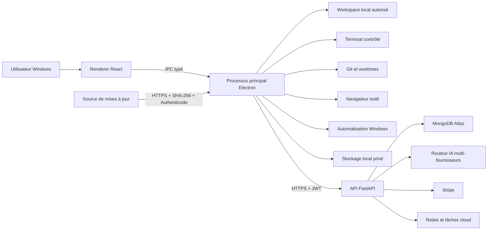
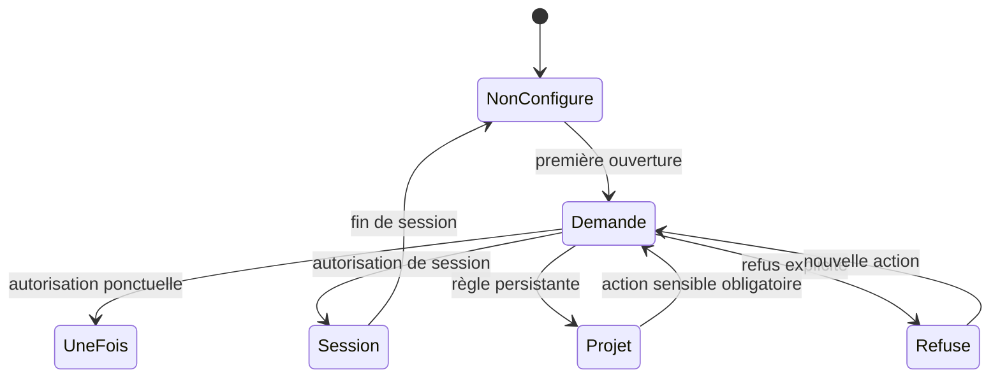
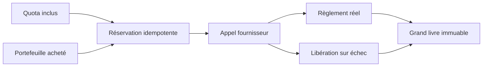
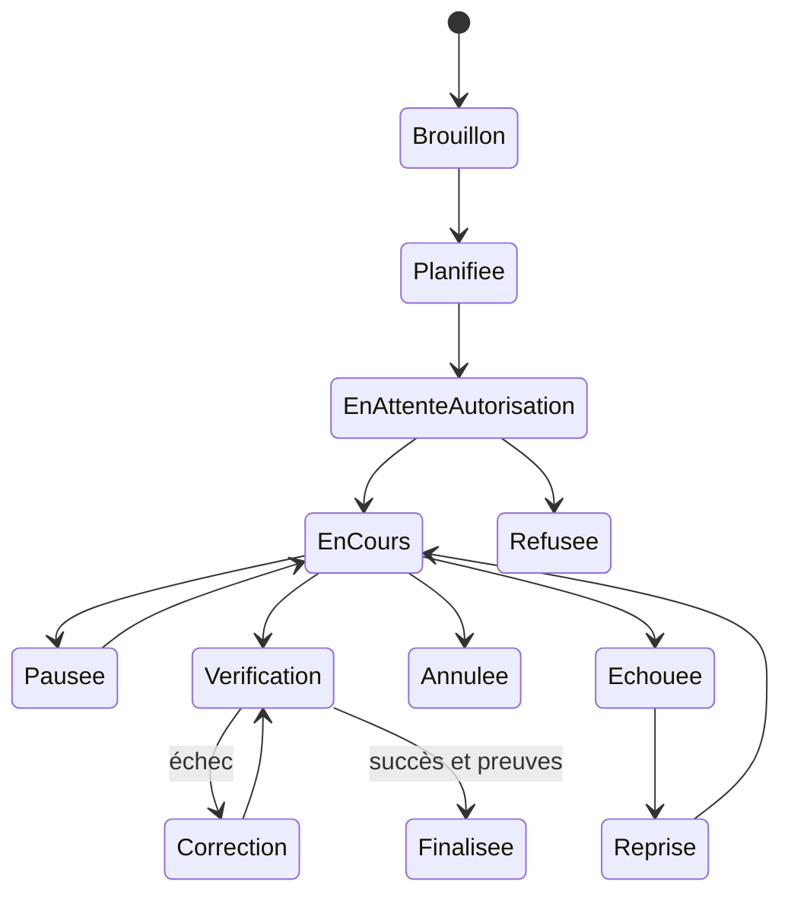

# NeuraCo — architecture et livrables techniques

Version du document : 2026-08-01

## 1. État des phases

| Phase | État vérifié | Preuves principales |
| --- | --- | --- |
| 1 — MVP local | Implémentée | Electron, authentification, workspace, éditeur, diff, terminal, permissions, checkpoints, Git, historique |
| 2 — Multimodèle et facturation | Implémentée | routeur serveur, fournisseurs, quotas, portefeuille, réservations, estimation et plafonds |
| 3 — Multi-agents | Implémentée | orchestrateur, agents spécialisés, graphe, budgets, worktrees, révision et fusion contrôlée |
| 4 — Navigateur et Cowork | Implémentée | navigateur isolé, localhost, diagnostics DOM/console, studio, documents, tableurs, présentations et PDF |
| 5 — Extensions | Implémentée | compétences, plugins, MCP, hooks, routines, GitHub/GitLab, SSH, WSL2 et Docker |
| 6 — Contrôle informatique | Implémentée avec protections | UI Automation, contrôle visuel, permissions par application, arrêt d’urgence, journal et blocages sensibles |
| 7 — Équipes et entreprise | Non implémentée | aucun espace collaboratif serveur, rôle d’équipe, budget partagé ou registre privé d’entreprise n’est exposé |

La phase 7 ne doit pas être affichée comme disponible tant que son isolation multi-tenant, ses politiques et sa comptabilité partagée n’ont pas été implémentées et testées.

## 2. Architecture complète



### Frontières de confiance

1. Le renderer n’a ni Node.js ni accès disque direct.
2. Le preload expose uniquement les méthodes définies par le contrat IPC.
3. Le processus principal valide l’origine IPC et applique les permissions projet.
4. Les fichiers restent locaux sauf action explicite nécessitant un contexte IA ou une synchronisation.
5. Le backend est l’autorité pour l’identité, les droits, les crédits, les modèles et l’administration.
6. Les fournisseurs IA ne reçoivent que le contexte sélectionné et nettoyé.
7. Les mises à jour non signées sont refusées.

## 3. Choix technologiques

| Couche | Choix | Justification |
| --- | --- | --- |
| Bureau | Electron + TypeScript | processus Windows natif, IPC contrôlé, mise à jour et intégrations locales |
| Interface | React + Vite | composants testables et build déterministe |
| Éditeur | Monaco | édition, diagnostics et langages réels |
| Backend | FastAPI | contrats Pydantic stricts et E/S asynchrones |
| Données cloud actuelles | MongoDB | compatibilité avec Neura Al-Nour et documents de conversations |
| Données locales actuelles | JSON atomique + fichiers | données lisibles, sauvegardables et isolées par service |
| Cible locale durable | SQLite | transactions et migrations pour les index volumineux ; schéma fourni séparément |
| Cible entreprise | PostgreSQL | contraintes relationnelles, RLS et comptabilité partagée ; schéma fourni séparément |
| Tests | Vitest + Pytest | tests unitaires renderer/main et backend |

PostgreSQL et SQLite sont des cibles documentées, pas les moteurs actuellement actifs. Une migration future doit conserver la compatibilité et ne doit pas être simulée par de simples fichiers SQL.

## 4. Structure des dossiers

```text
neuraco/
  electron/       processus principal, IPC et services système
  src/            interface React
  cli/            interface en ligne de commande
  sdk/            client typé
  extensions/     intégrations IDE
  scripts/        build et vérifications Windows
  public/         ressources non sensibles
  docs/           architecture et schémas
backend/
  server.py       API FastAPI et autorité serveur
  tests/          tests backend ciblés
```

## 5. Contrats API

Les routes sont préfixées par `/api`. Les routes protégées exigent un JWT lié à une session serveur active.

| Domaine | Routes principales | Autorité |
| --- | --- | --- |
| Identité | `/auth/login`, `/auth/me`, `/auth/sessions`, `/auth/account` | serveur |
| Confidentialité | `/auth/privacy`, `/auth/account/delete`, `/neuraco/telemetry` | serveur |
| Accès | `/neuraco/access`, `/neuraco/download`, `/neuraco/update` | serveur |
| Agent | `/neuraco/agent`, tâches cloud, reprise | serveur |
| Usage | estimation, réservation, règlement, historique | serveur |
| Administration | `/neuraco/admin/*` | rôles fondateur/admin |
| Relais | appareils, commandes et tickets à usage unique | serveur |

Règles : Pydantic valide les entrées, les erreurs publiques n’exposent pas les exceptions internes, les téléchargements utilisent des tickets courts et les actions coûteuses sont idempotentes.

## 6. Contrat IPC

La source de vérité est `electron/ipc-contract.ts`. Le preload ne doit exposer aucune primitive générique de fichier, shell ou réseau. Chaque canal :

- a un nom constant `neuraco:*` ;
- reçoit un objet typé ;
- valide l’URL du renderer avec `ensureTrustedSender` ;
- exécute l’autorisation dans le processus principal ;
- renvoie un résultat sérialisable ;
- journalise les actions importantes sans secrets.

## 7. Système de permissions



Les suppressions importantes, opérations Git destructives, élévations, paiements, transferts, publications et accès aux secrets restent confirmés même avec une règle large.

## 8. Modèle des agents

Un agent contient : identifiant, nom, rôle, instructions, modèle, outils, applications et dossiers autorisés, budget, autonomie, mémoire contrôlée, couleur et icône. L’orchestrateur produit des affectations et un graphe. Chaque affectation contient son budget, ses dépendances, son état, son worktree et ses preuves. Le réviseur est indépendant de l’agent développeur.

## 9. Modèle des crédits



Le coût est calculé sur les compteurs fournisseur lorsque disponibles. Le client n’est jamais l’autorité du solde.

## 10. Machine d’état des tâches



## 11. Worktrees et fusion

Chaque tâche parallèle reçoit une branche et un worktree dédiés. Un verrou empêche deux agents d’écrire le même fichier. Avant fusion : détection des conflits, tests, revue indépendante, présentation des différences et autorisation. Un worktree n’est supprimé qu’après fusion ou abandon confirmé.

## 12. Stratégie de sandbox

- racine projet résolue et vérifiée pour chaque chemin ;
- exclusion des secrets, VCS internes, dépendances et gros binaires du contexte ;
- commandes évaluées avant exécution ;
- variables d’environnement filtrées ;
- processus descendants placés dans un Job Object Windows quand disponible ;
- navigateur et vues web isolés ;
- domaines réseau contrôlés ;
- arrêt d’urgence global ;
- checkpoint avant action risquée.

## 13. Modèle de menace

| Menace | Protection |
| --- | --- |
| Renderer compromis | isolation de contexte, sandbox, IPC fermé, navigation bloquée |
| Traversée de chemin | résolution canonique et contrôle de racine |
| Injection par contenu | délimitation non fiable, outils autorisés, confirmations |
| Exfiltration de secret | détection, masquage, exclusion `.env`, télémétrie fermée |
| Commande destructive | évaluation, permissions, confirmation et checkpoint |
| Vol de session | stockage chiffré OS, session serveur révocable, 2FA |
| Fraude de crédits | autorité serveur, réservations et grand livre |
| Mise à jour malveillante | HTTPS, SHA-256, Authenticode, manifeste et rollback vérifiés |
| Plugin malveillant | manifeste, signature/confiance, périmètre et désactivation admin |
| Automatisation PC abusive | allowlist d’applications, preuve visuelle, arrêt d’urgence |

## 14. Maquettes fonctionnelles

Les maquettes de référence sont les écrans exécutables actuels :

1. Accueil : navigation gauche, état de sécurité, espace projet et compositeur.
2. Workspace : conversation centrale, outils projet, panneaux éditeur/terminal/Git/tests.
3. Équipe d’agents : agents, affectations, graphe, budgets et journal de coordination.
4. Compte : profil, sessions, 2FA, consommation et confidentialité.
5. Administration : configuration, opérations et audit.

Aucun écran ne doit présenter un contrôle activé sans service réel associé.

## 15. Plan de tests

1. Tests unitaires de chaque service et composant.
2. Tests d’intégration IPC avec sender non fiable refusé.
3. Tests backend des droits, quotas, tickets, confidentialité et administration.
4. Build TypeScript/renderer.
5. Lancement Electron réel et contrôle visuel.
6. Scénario projet React/TypeScript.
7. Scénario backend Python.
8. Scénarios Git, compilation en échec, correction, rollback et reprise.
9. Packaging, installation, lancement, désinstallation, réinstallation et mise à jour signée.
10. Tests de non-régression sans appel payant non autorisé.

## 16. Déploiement

1. Exécuter build et suites de tests.
2. Vérifier l’absence de secrets et la provenance des dépendances.
3. Générer l’installateur Windows avec certificat de signature externe.
4. Vérifier Authenticode et calculer SHA-256.
5. Publier l’artefact stable/bêta privé côté backend.
6. Enregistrer version, notes, minimum supporté et déploiement progressif.
7. Tester le ticket de téléchargement puis une installation propre.

## 17. Mises à jour

Le client consulte le canal choisi, télécharge par ticket authentifié, vérifie taille, hash et signature, crée un checkpoint, attend la fin des tâches critiques et lance l’installateur. Seuls les anciens installateurs possédant une preuve locale de vérification complète sont proposés au rollback.

## 18. Étapes restantes

1. Obtenir un certificat Authenticode public et protéger son accès CI.
2. Exécuter le cycle installé complet avec ce certificat.
3. Concevoir la phase 7 multi-tenant avant tout affichage d’équipe entreprise.
4. Migrer vers PostgreSQL/SQLite seulement avec double écriture, vérification et rollback.

